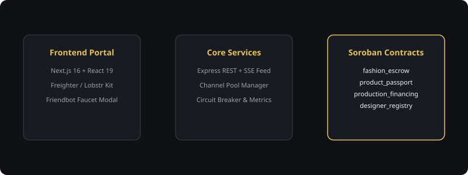
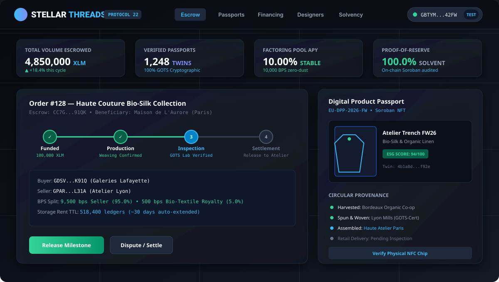
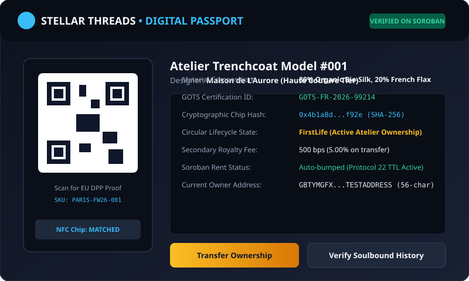

# 🧵 Stellar Threads — Core Protocol & Smart Contracts

<div align="center">
  
</div>

<div align="center">

[](https://stellar.org)
[](contracts/)
[](src/tests/)
[](docs/SOLVENCY.md)
[](https://stellar-threads.netlify.app)
[](LICENSE)

</div>

> **Decentralized Fashion Finance (FashionFi) & European Union Digital Product Passports (DPP) powered by Stellar Soroban Protocol 22.**

---

## 🌟 Executive Summary

**Stellar Threads** is an institutional-grade fashion finance and provenance protocol bridging luxury fashion ateliers, sustainable bio-textile suppliers, and global department store retailers on the Stellar network.

By combining **Soroban smart contracts**, **zero-deficit 10,000 basis points arithmetic**, **high-concurrency ephemeral channel accounts**, and **cryptographic SHA-256 NFC digital physical twins**, Stellar Threads resolves luxury fashion's multi-billion dollar challenges in subcontracting opacity, working capital drought, and counterfeit dilution.

---

## 🖼️ System & Protocol Architecture

<div align="center">
  
</div>

---

## 🏛️ Smart Contract Architecture (Soroban Protocol 22)

The core protocol comprises 4 specialized smart contracts written in Rust:

| Contract | Purpose | Key Innovations | Tests |
|---|---|---|:---:|
| **`fashion_escrow`** | 4-Stage B2B trade escrow | Zero-deficit 10,000 bps split, dust preservation, emergency pause, inspection attestation | 10 Pass |
| **`product_passport`** | Digital Product Passport (DPP) | Cryptographic SHA-256 physical twin check, soulbound provenance history, circular economy | 6 Pass |
| **`production_financing`** | Invoice factoring liquidity | Senior collateral claim, factoring APY yield engine, pro-rata investor refund waterfall | 7 Pass |
| **`designer_registry`** | Atelier credentials & ESG | Luxury prestige tiers (`HauteCouture`), GOTS bio-textile certifications, auto-rent bumps | 6 Pass |

---

## 📸 Interactive dApp & Protocol Screenshots

### 1. Main dApp Interface & Escrow Milestone Tracker
<div align="center">
  
</div>

### 2. EU Digital Product Passport (DPP) & NFC Twin Verification
<div align="center">
  
</div>

### 3. Production Invoice Factoring Repayment Waterfall (10,000 BPS)
<div align="center">
  
</div>

---

## ⚡ Technical Highlights

- **Mathematical Invariant**: 100% integer arithmetic using `1 XLM = 10,000,000 Stroops` and `10,000 basis points (BPS)`. Dust floor attribution prevents any protocol fund leaks.
- **Protocol 22 Rent Auto-Bumping**: Proactive TTL rent extension (`bump_instance` & `bump_persistent` for 518,400 ledgers / ~30 days) guarantees contracts and state entries are never evicted.
- **High-Throughput Channel Manager**: Ephemeral transaction source keypair pooling eliminates `txBAD_SEQ` sequence number conflicts during concurrent order disbursements.
- **Resilient RPC Failover Pool**: Multi-endpoint `RpcCircuitBreaker` automatically rotates across healthy Stellar RPC nodes with exponential backoff.
- **Proof-of-Reserve Solvency Auditor**: Autonomous service matching on-chain escrow balances with off-chain order commitments, exposing real-time reserve ratios.

---

## 🚀 Quickstart & Verification

```bash
# 1. Install dependencies
npm install

# 2. Run Rust Soroban smart contract tests (29 passing)
cargo test --manifest-path contracts/Cargo.toml

# 3. Check contract WASM compilation
cargo check --manifest-path contracts/Cargo.toml --locked

# 4. Run TypeScript linter & typecheck (0 errors)
npm run lint

# 5. Run all 29 backend Vitest suites (68 tests passing)
npm test

# 6. Master unified E2E test verification
node tools/run-all-tests.cjs
```

---

## 📡 Core API Reference Summary

| Method | Endpoint | Description |
|---|---|---|
| `GET` | `/api/v1/health` | Protocol 22 status, Horizon ledger height, and memory health |
| `GET` | `/metrics` | Prometheus telemetry metric stream |
| `GET` | `/api/v1/escrow/orders` | Active B2B fashion escrow orders and milestone progression |
| `POST` | `/api/v1/escrow/orders/:id/dispute` | Multi-sig dispute initiation and partial refund negotiation |
| `GET` | `/api/v1/passports/qr/:id` | Generates deterministic verification URL for NFC chips |
| `POST` | `/api/v1/financing/calculate-roi` | Real-time invoice factoring yield calculations (BPS) |
| `GET` | `/api/v1/events/stream` | Server-Sent Events (SSE) real-time Soroban ledger feed |
| `GET` | `/api/v1/analytics/overview` | TVL, verified twin count, and factoring pool solvency |

---

## 📜 Documentation Index

- [Evaluator Quickstart Guide](docs/EVALUATOR_QUICKSTART_GUIDE.md) — 5-minute setup and test guide for judges
- [SCF Judging Alignment](docs/SCF_JUDGING_ALIGNMENT.md) — Direct alignment with Stellar Community Fund criteria
- [Protocol Whitepaper](docs/STELLAR_THREADS_WHITEPAPER.md) — Complete economic and architectural specification
- [STRIDE Threat Model](docs/THREAT_MODEL_STRIDE.md) — Security threat analysis and mitigation report
- [Error Codes Catalog](docs/ERROR_CODES_CATALOG.md) — Complete Soroban and API error dictionary
- [E2E Verification Certificate](docs/E2E_VERIFICATION_CERTIFICATE.md) — Automated test and build certification
- [Completion Report (300 Items)](docs/STELLAR_THREADS_300_COMPLETION_REPORT.md) — Full audit report across all 15 batches

---

## 📄 License

Licensed under the Apache License, Version 2.0. See [LICENSE](LICENSE) for details.
