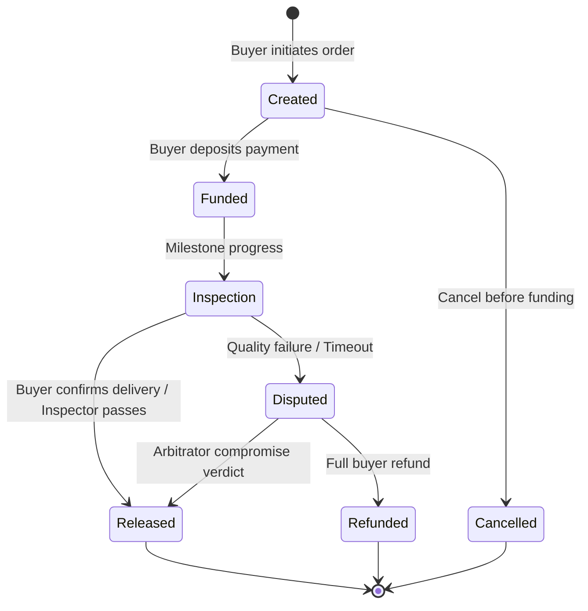

# Fashion Trade Escrow Lifecycle Specification

Detailed state machine specification for B2B fashion trade contracts on Stellar Soroban.

## Lifecycle States:
- **Created**: Order established with agreed price, token, and order reference.
- **Funded**: Escrow funds securely locked inside the contract.
- **Released**: Production verified; funds disbursed to fashion atelier.
- **Refunded**: Buyer refunded due to mutual agreement, dispute, or timeout.
- **Cancelled**: Order cancelled before any funds were deposited.
