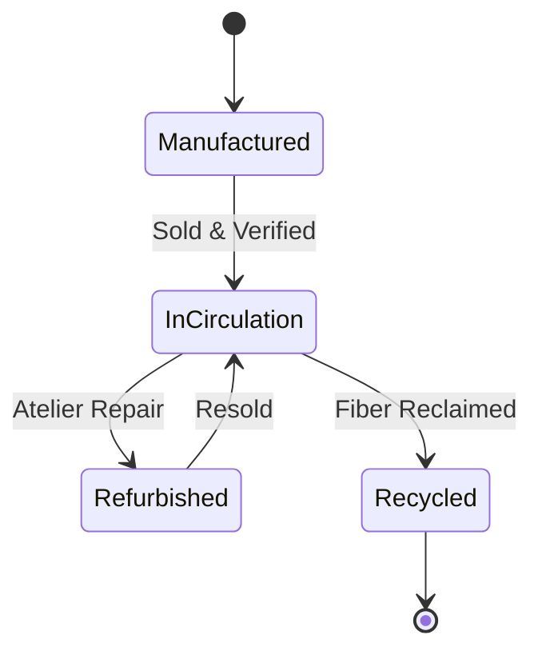

# Circular Fashion Economy Standard — Lifecycle States

## State Progression

## Rules
1. **Manufactured**: Garment minted on Soroban with organic mill certificate.
2. **InCirculation**: Ownership transferred via Soulbound / semi-fungible digital passport.
3. **Refurbished**: Official repair logged by verified atelier.
4. **Recycled**: Final end-of-life state permanently retiring garment NFT.
